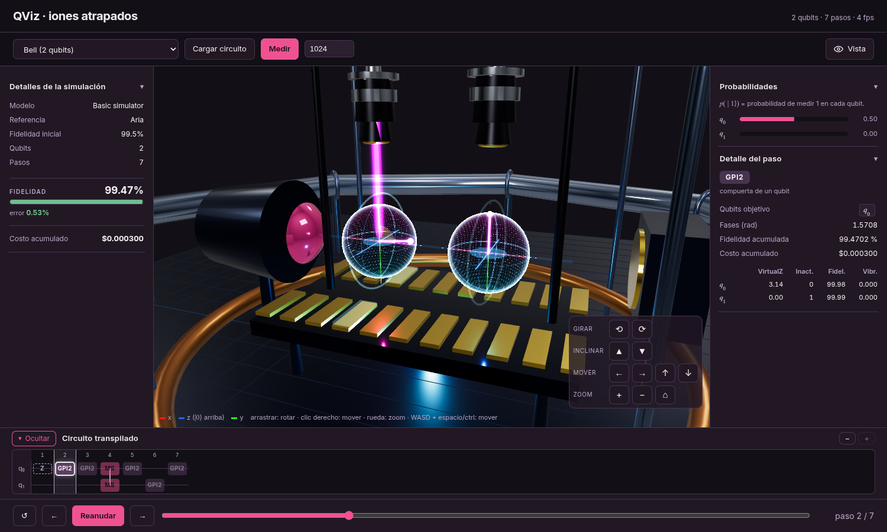
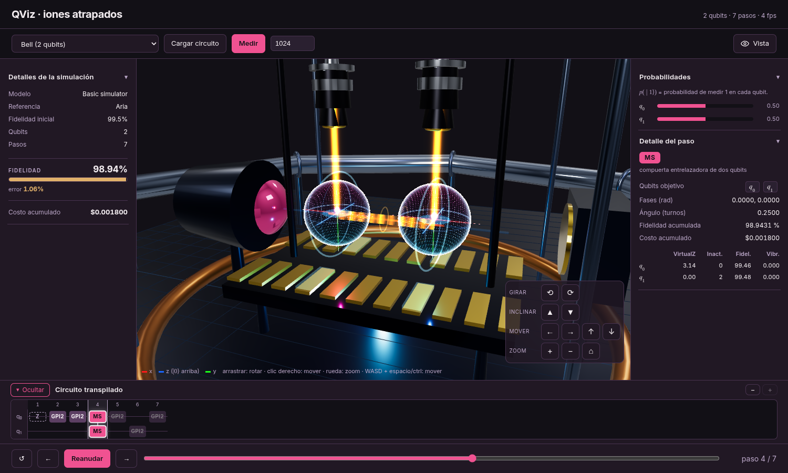

# QViz

[](https://github.com/iroumec/QViz/actions/workflows/ci.yml)
[](LICENSE)

**See what a trapped-ion quantum computer really does with your circuit.**



## What is it?

QViz is an educational visualiser for trapped-ion quantum computers. You give it
a quantum circuit written in OpenQASM 2 or 3 and a backend (IonQ or the
built-in simulator). QViz compiles the circuit into the **native gates** of an
IonQ machine, simulates it exactly, and draws every ion as a **Bloch sphere**
that moves, gate by gate, in a 3D model of the trap: the laser pulse that
drives each gate, the phonon bus between two ions, the electrodes and the
readout lens.

It runs entirely in the browser on [Qollab](documentation/docs/frontend/qollab.qmd)
(Python through Pyodide, the viewer in JavaScript with three.js), and also on
your own computer with one command.



## Why it matters and who it is for

A quantum program is written with logical gates (`h`, `cx`, `rz`). A trapped-ion
machine does not run them: it runs a handful of native gates, and a single `cx`
becomes a sequence of them. That gap between the circuit on the page and what the
hardware does is where understanding is usually lost.

QViz makes the gap visible. Its audience is **students, teachers and the curious**
who know the basics of circuits but not the hardware. No knowledge of trapped
ions is assumed, and the interface is in Spanish and English, so it can be used
in a classroom. What it lets you do:

- see how a logical gate is built from native gates, and what each one does to
  one ion;
- see **entanglement** appear: the Bloch vector of an ion shrinks, and vanishes
  when the ion is fully entangled;
- see **noise**: the fidelity of the circuit falls with every gate, and the
  **Medir** button shows what a measurement would give, correlations included;
- change how it looks (palettes for colour blindness, high contrast, reduced
  motion, a camera that works with the mouse alone) from the **Vista** button.

## How the quantum part works

### The native gates

A trapped-ion machine has two one-qubit gates and one entangler. QViz uses the
matrices of [IonQ's native gates](documentation/references/ionq_native_gates.md)
and checks every translation against them.

| Native gate       | What it does to the ions                                                                        | How it looks in QViz                                |
| ----------------- | ----------------------------------------------------------------------------------------------- | --------------------------------------------------- |
| **GPI(φ)**        | A π rotation about an axis of the equator of the Bloch sphere, set by the phase φ of the laser. | A long laser pulse on one ion.                      |
| **GPI2(φ)**       | A π/2 rotation about the same kind of axis.                                                     | A short laser pulse on one ion.                     |
| **VirtualZ(θ)**   | A Z rotation, done for free by shifting the phase of the gates that follow.                     | No pulse: only the phase changes.                   |
| **MS(φ₀, φ₁, θ)** | Mølmer–Sørensen: entangles two ions through the shared vibration of the chain (Aria).           | Two orange beams and a phonon bus between the ions. |
| **ZZ(θ)**         | The entangler of Forte, instead of MS.                                                          | The same, with `zz` steps.                          |

### The pipeline

```text
OpenQASM → provider → transpiler → translator → simulator → vectorizer → metrics → formatter → exporter → JSON → viewer
```

1. **provider** detects the backend (IonQ, Aria or Forte, or the built-in
   simulator) and picks its noise profile and entangler.
2. **transpiler** and **translator** rewrite the circuit with Qiskit, then into
   GPI, GPI2, MS or ZZ and VirtualZ. Each translation is tested with
   `Operator.equiv` against the original circuit.
3. **simulator** computes the exact statevector after every gate (no noise at
   this stage) and the reduced density matrix of each ion. The Bloch vector of an
   ion is read from it: its length `r` is 1 for a pure state and **less than 1
   when the ion is entangled**.
4. **metrics** adds a simple model of error: a fidelity per gate, a small error
   per idle step, a state-preparation-and-measurement error and an illustrative
   price. The numbers are order-of-magnitude values for teaching, not a
   calibrated model of a real machine.
5. **formatter** and **exporter** produce one JSON, checked against a schema.
   It is the only contract between Python and the viewer.
6. **Medir** samples a measurement with the same backend from the exact
   statevector, with a readout error per ion, so entangled states keep their
   correlations (a Bell pair gives `00` and `11`, never `01`).

### An example: the Bell pair

`h q[0]; cx q[0], q[1];` becomes seven native steps (the Aria profile):

| Step   | Native gate | Ions       | What happens                                                          |
| ------ | ----------- | ---------- | --------------------------------------------------------------------- | ---- |
| 1      | VirtualZ    | q₀         | Phase bookkeeping, no pulse.                                          |
| 2      | GPI2        | q₀         | The vector of q₀ goes to +x, on the equator.                          |
| 3      | GPI2        | q₀         | It goes on to −z (                                                    | 1⟩). |
| 4      | **MS**      | q₀, q₁     | The two ions entangle: both vectors vanish (`r = 0`).                 |
| 5 to 7 | GPI2        | q₀, q₁, q₀ | One-qubit rotations that complete the CNOT; the pair stays entangled. |

The fidelity falls from 99.5 % to about 98.8 %, most of it at the MS gate.

## Use it

### On Qollab

```bash
make qollab
```

Upload the **content** of the generated `qollab/` folder (not the folder
itself) to a Qollab JS project, and run it. The repository has more than the 100
files that Qollab allows, which is why the package is built. Python (Pyodide)
runs the backend and the browser draws the viewer, with the backend that you
select in Qollab (the built-in simulator or an IonQ simulator). Do not edit
`qollab/`. Loaded circuits are transpiled locally, so they never spend the one
IonQ job that each run allows.

### Locally

```bash
make venv && make install   # needs Python 3.12 or newer (see Versions)
make test                   # the test suite
make server                 # the viewer at http://localhost:8000 (PORT=9000)
make open                   # like server, but it opens the browser for you
```

Open the viewer, choose an example from the list or press **Cargar circuito**
(or drag a `.qasm` file onto the page). Try the files in `resources/examples/qasm/`
(`bell.qasm`, `ghz4.qasm`, `qft3.qasm`). Press **Play**, or move through the
steps with the arrows and the circuit strip, and press **Medir** to measure the
current step. `make server` runs the same Python code as Qollab. The viewer has
no calculation of its own: compiling and measuring go through Python. `make demo
M=translator` runs the demo of one module; the pipeline is described in the
[Quarto book](documentation/docs/concepts/pipeline-overview.qmd).

### Reading the viewer

The **Vista** (_View_) button, at the top right, opens the accessibility
options: profiles (focus on the vector, high contrast, colour blindness,
reduced motion), colour palettes, the shape of the sphere and the vector, what
to hide, light and text size. The camera buttons at the bottom right of the
scene, and the right mouse button, move the camera without the keyboard. The
choice is remembered in the browser. See
[`viewer.qmd`](documentation/docs/frontend/viewer.qmd).

## Project layout

| Path                                                              | What is in it                                                                              |
| ----------------------------------------------------------------- | ------------------------------------------------------------------------------------------ |
| `source/backend/core/`                                            | One package per module of the pipeline, plus the model, the errors and the noise profiles. |
| `source/frontend/`, `source/shaders/`                             | The viewer: `index.html` and the ES modules of `js/`, and its shaders.                     |
| `qollab_api.py`, `main.py`, `resources/scripts/package_qollab.py` | What Qollab runs and the script that builds the project to upload.                         |
| `resources/examples/`                                             | Example circuits in Python and OpenQASM.                                                   |
| `source/tests/`                                                   | The test suite (no network, IonQ is mocked).                                               |
| `documentation/`                                                  | The Quarto book (English), the schema and the references.                                  |

## Versions

| Piece               | Required     | Tested with                        | Notes                                                                                                                                           |
| ------------------- | ------------ | ---------------------------------- | ----------------------------------------------------------------------------------------------------------------------------------------------- |
| Python              | `>=3.12`     | 3.13.16 (CI: 3.12 and 3.13)        | Qollab runs 3.14 (Pyodide v314.0.7). Python 3.11 is refused by `pip install`.                                                                   |
| Qiskit              | `>=2.5.2,<3` | 2.5.2                              | Qollab ships 2.5.2.                                                                                                                             |
| qiskit-ionq         | `>=1.0.0,<2` | 1.0.0 to 1.1.1                     | Qollab ships 1.0.2. Before 1.0.3, tomography on a non-IonQ backend fails.                                                                       |
| NumPy               | `>=2.0,<3`   | 2.0.2 and 2.5.4                    | Qollab ships 2.4.6.                                                                                                                             |
| qiskit-qasm3-import | `>=0.6,<1`   | 0.6.0                              | Only for OpenQASM 3.                                                                                                                            |
| three.js            | n/a          | 0.186.1 (standalone and on Qollab) | Loaded from a CDN, so it is not in `requirements.txt`; Qollab provides its own. The standalone viewer uses the same version so both look alike. |

`pyproject.toml` and `requirements.txt` declare the same Python packages (a test
checks it). Details and the reasons: [installation](documentation/docs/getting-started/installation.qmd).
The last full run: 427 tests passed, 1 skipped, and `make lint` clean.

## Limitations

- At most 16 qubits (the exact statevector grows as 2ⁿ).
- Only IonQ (Aria, Forte, Harmony) and the built-in simulator; IBM, AWS and
  others are rejected with an explicit error.
- The noise is a simple didactic model, not a calibrated one, and no circuit is
  sent to real hardware.
- The viewer needs WebGL. Under Qollab, the standard three.js addons and the
  speed with 16 qubits are still being verified.
- Qollab does not serve the other files of a project and gives one IonQ job per
  run; the details and the workarounds are in
  [`qollab.qmd`](documentation/docs/frontend/qollab.qmd).
- The vectors of Bloch get shorter, or vanish, while a qubit is entangled
  (`r < 1`). This is expected, and it can happen in the middle of a two-qubit
  gate even if the circuit has no entanglement.
- Tomography (`strategy="tomography"`) on a non-IonQ backend needs
  qiskit-ionq ≥ 1.0.3.

## Documentation

The full book is built with Quarto from `documentation/` (`make render`). Good
places to start: [Why QViz](documentation/docs/concepts/motivation.qmd), the
[pipeline](documentation/docs/concepts/pipeline-overview.qmd), the
[viewer](documentation/docs/frontend/viewer.qmd) and
[running on Qollab](documentation/docs/frontend/qollab.qmd).

## Tools

Tools used during the project development:

<!-- markdownlint-disable MD033 -->
<table>
    <tr>
        <td align="center" width="96" style="background: transparent; border: none;">
            
            <br/>Python
        </td>
        <td align="center" width="96" style="background: transparent; border: none;">
            
            <br/>JavaScript
        </td>
        <td align="center" width="96" style="background: transparent; border: none;">
            
            <br/>HTML
        </td>
        <td align="center" width="96" style="background: transparent; border: none;">
            
            <br/>CSS
        </td>
        <td align="center" width="96" style="background: transparent; border: none;">
            
            <br/>NumPy
        </td>
        <td align="center" width="96" style="background: transparent; border: none;">
            
            <br/>Qiskit
        </td>
        <td align="center" width="96" style="background: transparent; border: none;">
            
            <br/>three.js
        </td>
        <td align="center" width="96" style="background: transparent; border: none;">
            
            <br/>Makefile
        </td>
    </tr>
    <tr>
        <td align="center" width="96" style="background: transparent; border: none;">
            
            <br/>Git
        </td>
        <td align="center" width="96" style="background: transparent; border: none;">
            
            <br/>GitHub
        </td>
        <td align="center" width="96" style="background: transparent; border: none;">
            
            <br/>GitHub Actions
        </td>
        <td align="center" width="96" style="background: transparent; border: none;">
            
            <br/>VS Code
        </td>
        <td align="center" width="96" style="background: transparent; border: none;">
            
            <br/>Bash
        </td>
        <td align="center" width="96" style="background: transparent; border: none;">
            
            <br/>uv
        </td>
        <td align="center" width="96" style="background: transparent; border: none;">
            
            <br/>pytest
        </td>
        <td align="center" width="96" style="background: transparent; border: none;">
            
            <br/>PlantUML
        </td>
    </tr>
    <tr>
        <td align="center" width="96" style="background: transparent; border: none;">
            
            <br/>Quarto
        </td>
        <td align="center" width="96" style="background: transparent; border: none;">
            
            <br/>Typst
        </td>
        <td align="center" width="96" style="background: transparent; border: none;">
            
            <br/>Gemini
        </td>
        <td align="center" width="96" style="background: transparent; border: none;">
            
            <br/>Claude Code
        </td>
        <td align="center" width="96" style="background: transparent; border: none;">
            
            <br/>OpenCode
        </td>
        <td align="center" width="96" style="background: transparent; border: none;">
            
            <br/>DeepSeek
        </td>
    </tr>
</table>
<!-- markdownlint-enable MD033 -->

## License

QViz is released under the [MIT License](LICENSE). It uses Qiskit, qiskit-ionq and
qiskit-qasm3-import (Apache-2.0) and NumPy (BSD-3-Clause) as dependencies, which
does not change the license of this code.
