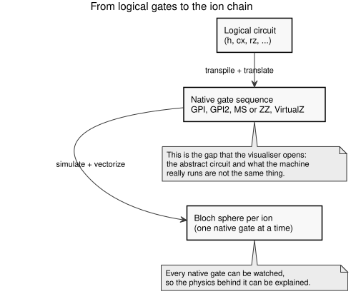

# Why QViz {#sec-motivation}

A quantum program is written with logical gates: `h`, `cx`, `rz`, and so on. But
a trapped-ion machine does not run those gates. It runs a small set of **native**
gates: GPI, GPI2, a two-qubit entangler (MS or ZZ), and a virtual Z rotation. The
logical circuit is transpiled and translated until only those gates remain.

The two pictures are very different. A single `cx` becomes a short sequence of
native gates, and each of them turns the state of an ion in a particular way.
This gap between the abstract circuit and the real machine is where the
understanding is often lost.

QViz makes the gap visible. The circuit is compiled into its native gates, and
the state of every ion is computed after **every** gate. A web page then draws
each ion as a Bloch sphere, step by step.

## What the visualiser allows {.unnumbered}

- To see how a logical gate is built from native gates.
- To see what one native gate does to one ion, and to the chain.
- To see entanglement appear: the Bloch vector of an ion shrinks, and disappears
  when the ion is fully entangled.
- To see the noise: the health of the circuit falls with every gate, and a
  noisier ion moves a little more.
- To explain the physics of each gate, because the state before and after the
  gate is on the screen.

## Who it is for {.unnumbered}

It is written for a general public and for teaching. No previous knowledge of
trapped-ion hardware is assumed. The interface is bilingual (Spanish and
English), so that it can be used in a classroom without a translation step.

## How to read the rest of the book {.unnumbered}

- [Getting started](../getting-started/installation.qmd) installs the project and
  shows a first example.
- [Core concepts](pipeline-overview.qmd) explains the pipeline, the units and the
  JSON contract.
- [Backend foundations](../modules/config-and-errors.qmd), [input and
  translation](../modules/transpiler.qmd), [simulation and
  output](../modules/simulator.qmd) and [orchestration and
  extras](../modules/compiler.qmd) document each module.
- [Examples](../examples/qft-adder.qmd) shows complete circuits, such as the QFT
  adder and the 16-qubit performance circuits.
- [Frontend](../frontend/viewer.qmd) documents the viewer.
