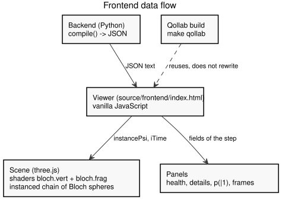

# Basic viewer {#sec-viewer}

A basic viewer is included for the JSON file. It is a tool to see the output of
the backend, and it is not the final frontend. It is written in plain
JavaScript: `source/frontend/index.html` draws 3D Bloch spheres with shaders, and it
loads three.js from a CDN.

The viewer is connected to the JSON files that
the project generates. The files are listed in `out/manifest.json`, which is
written by `make outputs`. The viewer reads the manifest, fills a selector with
the available files, and opens the default one. A new file appears in the
selector as soon as it is generated.

One three-dimensional Bloch sphere is drawn for every qubit, and the vector of
each sphere is animated from one step to the next. The ions are placed in a
single **chain**, one after another, so that the view resembles an ion trap; a
grid is not used. The scene can be rotated by dragging, and the zoom is changed
with the mouse wheel. The camera can also be moved with the keyboard: `W`, `A`,
`S` and `D` move it on the horizontal plane (relative to where it looks), the
space bar flies up and the left control goes down. The number of qubits and the
number of steps are shown, together with a live frame-rate counter, so that the
performance can be watched.



The spheres are drawn with the **shaders in the `source/shaders/` folder**
(`bloch.vert` and `bloch.frag`). The fragment shader is a volumetric
raymarcher: the axes, the state vector, the angle sweeps, the sphere shell and
the dotted grid are all computed from the ray. The vertex shader is instanced,
so one draw call covers every qubit. Each instance carries its own state vector
in the `instancePsi` attribute, and the animation is driven by the `iTime`
uniform. The `cameraPosition` uniform, which three.js provides automatically for
a `ShaderMaterial`, is used to trace the rays.

Because the shaders are separate files, and because the JSON files are read over
HTTP, the 3D viewer must be served by a local server. The commands are given
below.

The **laser beams** are drawn as well. Every ion has a lens above it, and a
volumetric beam connects the lens to the ion. The beam is a second instanced
mesh, with its own shaders (`laser.vert` and `laser.frag`): a box that bounds the
segment is raymarched, and the glow is computed from the distance to the beam
axis. One box is placed per ion, with the same instance matrix as its sphere, so
the beam is centred on its own ion. The colour follows the species of the
backend: magenta for ytterbium (Aria, Harmony), green for barium (Forte), and
violet when the species is unknown. The beam is cut by the two uniforms
`uLaserMinY` and `uLaserMaxY`, which are set from `source/frontend/js/config.js`
(`LASER_MIN_Y` and `LASER_MAX_Y`), so that it meets the lens exactly. `LASER_MAX_Y` is `LENS_Y`, so it follows the height of the device.

The lens is a detailed **laser head**: a fiber connector, a mounting flange with
bolts, a body with a focusing ring, a front barrel and a glass aperture, built by
`createLaserHead` in `source/frontend/js/laser.js`. The heads are not floating: they hang
from a **rail** above the chain, which is held by a post at each end.

A beam is **dark by default**. It is fired only for the target ions of a native
gate, and only while the step is applied, so no beam is left on. Each instance
carries its own intensity in the `instanceActive` attribute, and moving to a step
that does not fire the laser cancels a pulse that is still fading.

The pulse depends on the gate. The two-qubit entanglers fire both targets for
three times the length of a GPI2, with a colour of their own (neon orange), so a
two-qubit gate is told apart from a single-qubit one.

| Gate | Ions | Colour | Duration |
| --- | --- | --- | --- |
| GPI2 | target | species colour | `LASER_PULSE_MS` (650 ms) |
| GPI | target | species colour | `LASER_GPI_FACTOR × LASER_PULSE_MS` (2 ×, 1300 ms) |
| MS, ZZ | both targets | `LASER_ENTANGLER_COLOR` (neon orange) | `LASER_ENTANGLER_FACTOR × LASER_PULSE_MS` (3 ×, 1950 ms) |
| VirtualZ | none | — | — |

The species colour is magenta for ytterbium (Aria, Harmony), green for barium
(Forte) and violet when the species is unknown; it is returned by `laserColorFor`
in `source/frontend/js/laser.js`. The length and the colour of every pulse are returned
by `laserPulseFor` in the same file, from the constants in
`source/frontend/js/config.js`. The pulse has a flat top: it rises and falls in the
first and last 15 % of its length.

The automatic play waits for the pulse to finish before it moves to the next
step, so a long MS or ZZ pulse is never cut in the middle. The wait is
`PLAY_INTERVAL_MS` (700 ms) between steps, or the length of the pulse plus
`PLAY_MARGIN_MS` (150 ms) when the gate fires one.

## The two-qubit gate {.unnumbered}

A two-qubit gate (MS or ZZ) is shown with three elements, because the two ions
do not exchange light: the whole chain is one elastic spring, and the coupling
travels as a vibration (a phonon).

- **The phonon bus.** While the two lasers are on, an energy tube joins the two
  targets (`source/shaders/bus.vert` and `bus.frag`, built by `source/frontend/js/phonon.js`).
  The tube is drawn between the centres of the two ions, so it **passes through**
  the ions in between: the coupling is not local, it uses the whole chain. Its
  colour is the entangler colour, and two waves of different frequency run along
  it, so the flow reads as energy going back and forth.
- **The jiggle.** While the pulse runs, the ions between the two targets (and the
  targets themselves) swing up and down, the targets more than the ions in
  between, which resonate with the chain. The chain settles when the pulse ends.
- **The synchronized halo.** Once the pulse ends, the two targets carry a halo in
  the entangler colour that pulses in step (they share the time, so the two
  pulses are exactly in sync). It shows that the two ions are now entangled,
  through the vibration of the chain and not through the ions in between.

The halo is drawn by the sphere shader (`source/shaders/bloch.frag`), which reads the
`instanceEntangled` attribute of each instance.

The example circuit `bell_distant.json` (a Bell pair on q0 and q2) shows this
directly: the entangler acts on the two ends, and the bus and the jiggle reach
the ion in between, even though it is not a target.

## The surface-trap chip {.unnumbered}

The ions are held by a microfabricated **surface-trap chip** below the chain
(`source/frontend/js/trap.js`):

- A dark, mirror-like **silicon substrate** gives contrast to the lasers and the
  gold. It rests on four legs down to the optical table, so it is not floating.
- Two rows of **gold electrode pads**, segmented along the chain, shape the
  trapping potential on both sides of a central channel. The electrodes under an
  ion glow cyan while that ion is a target of the current step.
- A glowing **field ring** (a torus) encircles every ion: it is the
  radio-frequency quadrupole that holds it. The rings tilt slowly, and the ring
  of a target ion glows brighter.

The chain runs along X at `y = 0`, so the top of the substrate sits below it and
the ions float above the chip.

## The horizontal layer {.unnumbered}

At the height of the chain there is a second layer of optics
(`source/frontend/js/horizontal.js`):

- A broad **global Raman beam sheet** crosses the whole chain. It is invisible at
  rest and flashes with every gate (single- or two-qubit), in step with the
  vertical lasers. It spans from one side optic to the other, so its ends stay
  away from the end ions.
- A thin **phonon guide rail** threads the ion centres: it is the confinement
  axis, and the vibrational continuum. It is a faint blue thread at rest; between
  the two ions of a two-qubit gate it glows amber and pulses, with wave rings
  travelling along the segment.
- The **side optics** close the layer: a readout objective lens at one end of the
  chain and a mirror mount at the other. They sit far enough from the end ions,
  and each rests on a stand down to the optical table.

## The laboratory environment {.unnumbered}

The scene is set inside an ultra-high-vacuum chamber on an optical table
(`source/frontend/js/environment.js`):

- A dark anodised **optical breadboard** with a grid of threaded holes sits
  below everything.
- Two thick **copper Helmholtz coils** (above and below the trap) give the
  static magnetic field that defines the quantisation axis; steel posts hold
  them to the table.
- Every vertical laser is born from a detailed **laser head** above the ion (see
  the laser paragraph above).
- A polished **viewport ring** frames the scene, so the viewer feels inside the
  chamber. It has a floor anchor at each of its eight bends, like the supports of
  an above-ground pool: a post down to the table and a collar that embraces the
  ring.
- **Fog** (`FogExp2`) and a blue ambient light give the chamber its depth.

## The interface {.unnumbered}

The interface uses a small, dark palette: **Ink** (`#121016`) for the background,
**Plum** (`#211824`) for the panels and the bars, **Muted Violet** (`#48334f`)
for the thin borders, **Neon Rose** (`#f05291`) for the primary actions and the
accents, **Dusty Lilac** (`#b8a4c5`) for the secondary text, and **Warm White**
(`#f1ebef`) for the main text. The rose is used sparingly, so the important
elements stand out. The type is Inter, and the panels have thin borders, moderate
radii and short transitions.

## What is shown {.unnumbered}

- One Bloch sphere per qubit. The vector of the sphere is the `(x, y, z)` vector
  of that qubit at the current step. Its length is the length `r` of the reduced
  state: it is shorter than one when the qubit is entangled, and it is absent
  when the qubit is fully entangled (`r` is zero).
- The target qubits of the step are highlighted in yellow, and the corresponding
  sphere is brighter.
- Each ion carries a **decoherence heat**: its colour shifts towards red as its
  accumulated health drops. The health is the per-qubit `fidelities` of the step,
  which already mix the idle, 1Q and 2Q errors, so the colour only degrades and
  never goes back to a healthy one. No backend change is needed.
- A volumetric **laser beam** above each ion, from the lens down to the ion. It
  is dark by default and fires only for the target ions of a native gate: the
  species colour for GPI and GPI2, and a neon-orange colour for MS and ZZ, which
  lasts three times longer (see the laser paragraph above).
- The probability `p(|1⟩)` of each qubit — the probability of measuring **1**,
  not 0 — is shown with a bar in the **Probabilities** panel.
- A **Simulation details** panel on the left shows the model (with the ion
  species it references, when it is a simulator), the initial fidelity, the
  number of qubits and the number of steps, and the
  accumulated fidelity of the current step: the word for it (*Fidelidad* or
  *Fidelity*, from the language of the page), the percentage, a bar and the
  **total error** (the fidelity that was lost, `100 − fidelity`). The bar is
  green above 99 %, amber above 95 % and red below, and the error value takes the
  same colour. Below it, the **accumulated cost** of the current step is shown.
- When a gate is applied, the fidelity that it subtracted (the difference with
  the previous step, for example `−0.53`) is popped over the panel as a red
  number that floats up and fades, like a damage number in a game. At step 0 the
  panel shows the initial fidelity of the backend.
- The **Step details** panel shows a large **operation badge** (colour-coded by
  gate family) with a one-line description, the target qubits, and the fields of
  the step with readable names (*VirtualZ*, *Fidelidad acumulada*, *Costo
  acumulado*, …). The per-qubit fields (VirtualZ, inactivity, fidelity and
  vibration) are shown as a table with one row per qubit, so every value is read
  at a glance.

The **Simulation details** panel is on the left; the **Probabilities** and
**Step details** panels are on the right. Each one is collapsible: its title is a
button, and clicking it shows or hides the body. The titles follow the language
of the page (*Detalles de la simulación* / *Simulation details*, *Probabilidades*
/ *Probabilities* and *Detalle del paso* / *Step details*).

The `+z` axis is drawn upwards, and `|0⟩` is at the top. This follows the
standard convention that is used by the backend.

The expressions in the panels (the qubit labels, the kets, `p(|1⟩)` and the
readout correction) are written in the LaTeX style as **inline MathML**, so the
browser typesets them natively, with no maths library and nothing fetched at run
time. The helpers `qubitMath`, `ketMath`, `probOneMath` and `probCorrectionMath`
in `source/frontend/js/utils.js` build them. On the 3D canvas, where MathML cannot be
drawn, the same expressions use the Unicode subscripts and angle brackets (`q₀`,
`|0⟩`) from `qubitLabel` and `ket`.

## How a file is loaded {.unnumbered}

The viewer does not load JSON files from the user: a circuit must go through
the platform (transpilation, translation to native gates, simulation and
metrics) before it can be shown. There are three ways to see a circuit.

1. **The selector.** It lists the examples. Served over HTTP, they are the
   files of `../out/manifest.json`; in Qollab, they are compiled by the backend.
   If nothing is found, a small example that is stored inside the page is used.
2. **The load button** (*Cargar circuito*). A circuit written in OpenQASM 2 or 3
   (`.qasm`) is chosen, compiled by the backend and added to the selector.
3. **Drag and drop.** The same file is dropped anywhere on the page.

Loading a circuit needs Python to compile it. In Qollab, the page calls the
platform (`HOST.compileQasm`, see [the Qollab page](qollab.qmd)). Locally, run the
server of the project, which compiles with the same code on the built-in
simulator (see below). With a plain `python -m http.server` the viewer shows the
examples, and loading a circuit says that the server cannot compile.

A JSON file can be produced with the generator, which also writes the manifest.

```bash
make outputs
```

The files are written to `out/`, together with `out/manifest.json`. Any of them
can then be chosen in the selector of `source/frontend/index.html`, or dragged onto a
viewer.

The pages are served by a small local server, so that the shaders and the JSON
files can be read.

```bash
make outputs
make server            # or: make server PORT=9000
make open              # like server, but also opens the browser
# then open http://localhost:8000/frontend/index.html
```

`make server` runs `resources/scripts/server.py`. It serves the repository like
`python -m http.server`, and it adds `POST /api/compile`: the body is the OpenQASM
text, the optional query has `shots` and `entangler` (`auto`, `ms` or `zz`), and
the reply is the JSON of the visualization. It calls `qollab_api.run_qasm`, so the
result is what Qollab gives, except that the machine is always the built-in
simulator. A circuit that cannot be compiled answers `400` with
`{"error": "..."}`, which the viewer shows in its error line. The server listens
on `127.0.0.1` only, and it asks the browser not to cache.

## The controls {.unnumbered}

The controls that run the simulation (the step buttons, the play button, the
reset, the slider and the step counter) are in a bar at the **bottom** of the
page; the file selector, the load button and the measurement are at the top.

| Control | Effect |
| --- | --- |
| Load circuit | Opens the file selector for an OpenQASM file (`.qasm`). |
| Example | Loads the small example that is embedded in the page. |
| Left arrow | Moves to the previous step. |
| Play / Pause | Plays the steps automatically, or pauses. It reads *Reanudar* when paused in the middle and *Reiniciar* once the last step is reached. |
| Right arrow | Moves to the next step. |
| Reset | Stops the play and returns to step 0. |
| Slider | Jumps directly to a step. Step 0 is the initial state. |
| Step counter | Shows the current step and the total (`paso 3 / 24`). |
| Medir | Measures the current step and shows the distribution of the results. |
| shots | The number of shots used by Medir (1024 by default). |
| Drag (left button) | Rotates the camera around the chain. |
| Drag (right button) | Moves the camera in the plane of the screen; the menu of the browser does not open. |
| Wheel | Zooms in and out. |
| `W`, `A`, `S`, `D` | Moves the camera on the horizontal plane. |
| Space | Flies the camera up. |
| Left control | Moves the camera down. |
| Camera buttons | Rotate, tilt, zoom and centre the camera (hold to keep moving); see *The View panel*. |
| Vista | Opens the panel with the profiles and the view options. |

Step 0 is the initial state, in which every qubit is in `|0⟩`. It is not part of
the JSON; it is added by the viewer, in the same way as the frontend is expected
to do.

## The View panel {.unnumbered}

The **Vista** (*View*) button is always at the right of the top bar, with an eye
icon. It opens a panel with the options that make the scene easier to read. A
profile is a quick set of values; below them, every option can be changed by
itself (the profile then reads as custom). **Restablecer** goes back to the
default profile. Esc, a click outside or the button close the panel.

| Profile | What it does |
| --- | --- |
| Predeterminado | The default look: a solid sphere with a dim shell and a thick, bright vector. |
| Enfoque en el vector | Hides the environment, the trap, the horizontal layer, the lasers and the phonon bus, dims the light and thickens the vector. |
| Alto contraste | A palette of saturated colours on a dark scene without the environment, and stronger text and borders in the interface. |
| Daltonismo | The Okabe and Ito palette (orange, sky blue and yellow axes, a pink vector) and the numbers of each vector. |
| Movimiento reducido | No jiggle, halo, wobble of the sphere, sweep of the moving light or animated transitions. It is the starting value when the system asks for less motion (`prefers-reduced-motion`). |

The options are in five sections:

- **Color.** The palette of the axes, the vector and the sphere: default, Okabe
  and Ito, high contrast and monochrome. The legend of the axes follows it.
- **Esfera y vector.** The blending of the sphere (*solid* covers what is behind
  it; *glow* adds to it, which washes out to white over a bright background),
  the level of detail (full, simple without dots or sweeps, outline only), the
  glow of the sphere, the brightness and the thickness of the vector, whether the
  spheres are drawn in front of everything, and whether the `(x, y, z)` of each
  vector is written under its sphere.
- **Qué se muestra.** Each group of the scene can be hidden: the environment, the
  trap chip, the horizontal layer, the vertical lasers, the phonon bus, the jiggle,
  the halo, the qubit labels, the legend and the camera buttons.
- **Luz y movimiento.** The brightness of the scene (the exposure), the intensity
  of the lights, the brightness of the vertical lasers and of the global beam
  sheet (to see them dimmer without hiding them, which *Qué se muestra* does) and
  the reduced motion.
- **Interfaz.** The size of the text (90 to 130 %, which also widens the side
  panels) and a stronger text and border contrast.

The choice is kept in the browser (`localStorage`, key `qviz.view`); without
storage the viewer starts with the defaults and works the same. `settings.js`
holds the values and imports no module of the scene; `scene.js` applies them
(`applyViewToScene`: the uniforms of the sphere shader, the visibility of the
groups, the lights and the exposure) and `viewpanel.js` draws the panel.

**The camera with the mouse alone.** Everything that the keyboard does can be
done with the pointer: the left button drags to rotate, the right button drags
to move, and the wheel zooms. The pad at the bottom right of the scene repeats
it with buttons, in four rows: rotate, tilt, move (left, right, up, down) and
zoom with the centre button. A button keeps acting while it is held, with the
mouse, the touch screen or the keyboard (Enter or Space on a focused button), so
the camera can be moved without the letter keys and without a right button. The step is announced to screen readers in a
polite live region (*Paso 3 de 7: GPI2 en q0. Fidelidad 99.44 %.*).

## The circuit timeline {.unnumbered}

A strip between the scene and the playback bar shows the **transpiled circuit**:
one wire per qubit and one column per step, with the native gates in order
(GPI, GPI2, MS, ZZ and VirtualZ as a dashed `Z`), in the palette of the interface:
plum boxes for the single-qubit gates, neon rose for the entanglers (like the badge
of the step details) and a muted dashed outline for VirtualZ. A two-qubit gate is a box on
each target joined by a vertical line, which crosses the wires in between when
the qubits are not adjacent. It reads only `steps[].operation`, `targets` and
`step`, so the JSON contract is not changed.

- The gates that were applied are filled, the current one has a warm white
  border and a soft glow, and the ones to come are dimmed. A lilac column marks the
  current step.
- A click on a gate goes to its step and stops the play. The strip scrolls by
  itself to keep the current step in the middle. A tooltip gives the step, the
  operation, the qubits and the accumulated fidelity.
- While the pointer is over a gate (or a box has the keyboard focus), a **selection
  marker** fades in around its ions: four thin neon rose arcs that face the camera
  and turn slowly, like the selection of a unit in a game. A two-qubit gate marks
  both ions. It is `selection.js`, driven by `state.hovered`.
- For **long circuits**, the **−** and **+** buttons in the header change the zoom
  (labelled boxes, small boxes, thin marks with a step number every 10), and the
  choice is remembered. The background of the strip can be dragged to pan it, the
  wheel moves it sideways when there is nothing to scroll vertically, and a click
  on a step number goes to that step. The strip scrolls by itself, so a play over
  hundreds of steps keeps the current one in the middle.
- The keys left and right change the step, and Home and End go to the first and
  the last one (unless the focus is in a field).
- It is open at the start. The **Hide** button (with a chevron) at the left of its header, next to the
  playback buttons,
  closes it, and the choice is remembered in `localStorage` when the page allows
  it. The scene resizes with a `ResizeObserver`. Below 860 px wide it is hidden.

## When a circuit cannot be shown {.unnumbered}

The viewer always opens, even when the compilation fails. A failure puts a short
red line under the controls and a **card over the scene** (`reportError` in
`utils.js`) that cannot be missed; the cross closes it, and a successful load
removes it. A machine that QViz does not support (IBM, AWS or any other that is
not IonQ or the built-in simulator) gets its own card: "Máquina no soportada",
what to do (choose IonQ Aria or Forte, or the built-in simulator) and, in small
text, the message of the backend with the machine that was detected. The Qollab
prelude tells the two apart because it keeps the class of the Python error in
`error.kind` (`UnsupportedProviderError`); any other error shows the generic card
"No se pudo mostrar el circuito" with its message. The same card is used when a
file that was loaded or chosen from the list fails.

## The measurement {.unnumbered}

The `Medir` button draws a number of shots from the probabilities of the current
step, and shows the distribution of the resulting bitstrings. The measurement is
done in the browser, from the fields of the JSON, so no job is sent to a
backend.

The measurement is also shown in the scene as **state-dependent fluorescence**
(`source/frontend/js/measurement.js`), the way a trapped-ion measurement really works.
The individual vertical lasers are not fired; the horizontal layer does the
illumination.

1. A broad **readout beam** floods the whole chain (the global beam sheet turns
   green and bright).
2. An ion in `|1⟩` is on resonance and scatters photons, so it **glows**; an ion
   in `|0⟩` is off resonance and **stays dark**.
3. The photons are collected by the **side readout lens**: a stream of particles
   flies from every `|1⟩` ion into the lens.
4. The outcome is resolved: a **`|0⟩` or `|1⟩` badge** appears above every ion.

The animation uses the most likely outcome of the sampled shots, and runs next to
the histogram when the `Medir` button is pressed. The panel shows the **step** and
the number of **shots** as two clear blocks at the top, and every expression (the
qubit labels, `p(|1⟩)` and the readout correction) is typeset as MathML.

The fidelity of each qubit is taken into account. The probability `p` of a qubit
is pulled towards `0.5` by its fidelity `f`:

$$
p' = 0.5 + (p - 0.5) \cdot f.
$$

At `f = 1` the probability is unchanged. At `f = 0` the qubit is fully random.
This is the same as a readout error of `(1 - f) / 2`. A noisier qubit therefore
gives a flatter distribution.

The JSON contains only the **reduced** (marginal) probability of each qubit, and
the marginals cannot give the correlations of an entangled state. Drawing every
qubit independently would give a Bell pair `00`, `01`, `10` and `11` with 25 %
each, which does not model entanglement at all. The viewer therefore **never**
measures by itself: it always asks Python (Qollab, or `make server`), and if there
is none, it shows an error instead of a wrong histogram.

The measurement is done by the backend: `sample` draws the outcomes from the
statevector and keeps the correlations, so a Bell pair gives only `00` and `11`.
See the [sampler page](../modules/sampler.qmd). The viewer asks the backend
(`HOST.sample` on Qollab, `POST /api/sample` of `make server` locally). The way it
is connected is on the [viewer on Qollab](qollab.qmd) page.

## How the animation works {.unnumbered}

The vector of each sphere is moved smoothly towards the value of the new step. A
small oscillation is added in proportion to the `vibration` value of the qubit,
so that a noisy qubit appears to shake.

## The fields that are read {.unnumbered}

The viewer reads only the fields of the contract. The fields that are used are
`backend`, `total_qubits`, `initial_fidelity`, and, for each step, `step`,
`operation`, `targets`, `phases`, `angle`, `cumulative_fidelity`,
`cumulative_cost`, `states`, `probabilities`, `virtual_z`, `inactivity`,
`fidelities` and `vibration`.

## The files of the viewer {.unnumbered}

The viewer is a set of small ES modules, so that each file has one purpose.
`source/frontend/index.html` holds only the markup and the style; the script starts at
`source/frontend/js/main.js`.

| File | Purpose |
| --- | --- |
| `js/main.js` | The entry point: reads the view options, wires the controls, builds the scene and loads the first file. |
| `js/settings.js` | The view options: defaults, palettes, profiles and their storage. It imports only `state.js`. |
| `js/viewpanel.js` | The *Vista* button and its panel (profiles and options), and the interface options (text size, contrast, reduced motion). |
| `js/camerapad.js` | The on-screen camera buttons (rotate, tilt, zoom, centre). |
| `js/config.js` | The constants, the URLs and the host hooks (`window.QVIZ_HOST`). |
| `js/state.js` | The mutable state of the viewer, in one place. |
| `js/utils.js` | Small helpers (`showStageMessage`, `escapeHtml`, `setError`). |
| `js/demo.js` | The small example embedded in the page. |
| `js/shaders.js` | Loads the eight shader sources (the spheres, the lens, the laser and the phonon bus). |
| `js/three-addons.js` | Loads the three.js addons, with a fallback. |
| `js/laser.js` | Loads the laser model, and builds the volumetric beams and their colour. |
| `js/phonon.js` | Builds the phonon bus, and runs the jiggle and the synchronized halo of a two-qubit gate. |
| `js/trap.js` | Builds the surface-trap chip (substrate, gold pads and field rings) and lights the active electrodes. |
| `js/horizontal.js` | Builds the horizontal layer (global beam sheet, guide rail, side optics) and animates it. |
| `js/measurement.js` | Runs the state-dependent fluorescence animation (readout beam, flares, photons and state badges). |
| `js/environment.js` | Builds the vacuum chamber and optical table (breadboard, coils, collimators, viewport) and sets the fog and lights. |
| `js/scene.js` | The scene, the camera, the render loop and the frame-rate counter. |
| `js/panels.js` | The panels (probabilities, simulation details, step details), the fidelity and the measurement. |
| `js/data.js` | Loads a visualization and moves through its steps. |
| `js/timeline.js` | The circuit timeline strip: builds the wires and gates, and marks the current step. It does not import `data.js` or `controls.js` (the controls wire the click). |
| `js/selection.js` | The selection marker around the ions of the gate that the pointer is over in the timeline. |
| `js/controls.js` | The playback bar (step buttons, play, reset, slider) and the drag and drop. |

No module imports a module that imports it back, so the dependency graph is easy
to follow. A headless test (a stub DOM and a stub `three`) runs the modules
without a browser.
