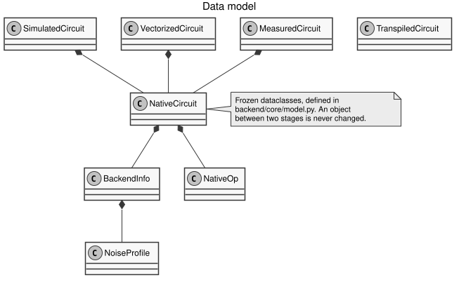

# Data model {#sec-model}

Every object that travels between the pipeline stages is defined in
`source/backend/core/model.py`. All the objects are **frozen dataclasses**. A frozen
dataclass cannot be changed after it is created, so the pipeline functions are
easy to keep pure.

## Type aliases {.unnumbered}

| Alias | Allowed values | Meaning |
| --- | --- | --- |
| `Provider` | `"ionq"`, `"local"`, `"unsupported"` | The family of the backend. `compile` rejects `unsupported`. |
| `Entangler` | `"ms"`, `"zz"` | The two-qubit native gate that is used for entanglement. |
| `OpName` | `"gpi"`, `"gpi2"`, `"ms"`, `"zz"`, `"virtual_z"` | The name of a native operation. |
| `Source` | `"ionq-native"`, `"qiskit"` | How a transpiled circuit was produced. |
| `Strategy` | `"statevector"`, `"tomography"` | How the state of the qubits is found. |

## `NoiseProfile` {.unnumbered}

The didactic noise parameters of a reference machine. All the fidelities are
numbers in the range [0, 1]. The prices are in US dollars per gate-shot.

| Field | Type | Meaning |
| --- | --- | --- |
| `spam_error` | float | The state-preparation-and-measurement error. |
| `fidelity_1q` | float | The fidelity of a single-qubit gate. |
| `fidelity_2q` | float | The fidelity of a two-qubit gate. |
| `idle_error_per_step` | float | The error added to a qubit that is not used in a step. |
| `price_1q` | float | The price of a single-qubit gate, in USD per shot. |
| `price_2q` | float | The price of a two-qubit gate, in USD per shot. |

## `BackendInfo` {.unnumbered}

The result of the provider detection. It is produced by `provider.detect`, and it
is carried through the whole pipeline.

| Field | Type | Meaning |
| --- | --- | --- |
| `provider` | `Provider` | The detected provider. |
| `name` | string | The raw name of the backend, as given by the platform. |
| `display_name` | string | The readable name used in the JSON. |
| `entangler` | `Entangler` | The target entangler, `"ms"` or `"zz"`. |
| `is_hardware` | bool | `True` only for real IonQ hardware, which spends credits. |
| `profile` | `NoiseProfile` | The noise profile of the reference machine. |

## `TranspiledCircuit` {.unnumbered}

The result of the transpiler. Either `circuit` or `native_ops` is set, but never
both.

| Field | Type | Meaning |
| --- | --- | --- |
| `source` | `Source` | `"qiskit"` for a normal circuit, `"ionq-native"` for native gates. |
| `num_qubits` | int | The number of qubits of the transpiled circuit. |
| `circuit` | `QuantumCircuit` or `None` | The transpiled Qiskit circuit. |
| `native_ops` | tuple of dict or `None` | A raw IonQ native gate list, when the API form is received. |
| `layout` | tuple of int or `None` | The mapping from user qubits to physical qubits. |

## `NativeOp` {.unnumbered}

A single native operation of the intermediate representation.

| Field | Type | Default | Meaning |
| --- | --- | --- | --- |
| `name` | `OpName` | required | The gate name. |
| `targets` | tuple of int | required | The qubits the gate acts on. |
| `phases` | tuple of float | `()` | Phases in radians. One value for `gpi` and `gpi2`, two for `ms`. |
| `angle` | float or `None` | `None` | The entanglement angle in turns, for `ms` and `zz`. |
| `z_rotation` | float or `None` | `None` | The rotation in radians, for `virtual_z` only. |
| `source_index` | int or `None` | `None` | The index of the original instruction, used for traceability. |

## `NativeCircuit` {.unnumbered}

A circuit that is made only of native operations.

| Field | Type | Meaning |
| --- | --- | --- |
| `backend` | `BackendInfo` | The backend information. |
| `num_qubits` | int | The number of qubits after compaction. |
| `ops` | tuple of `NativeOp` | The operations, in temporal order. |

## `QubitAngles` {.unnumbered}

The reduced state of one qubit, in spherical coordinates. See
[Units and conventions](../concepts/units-and-conventions.qmd) for the definitions.

| Field | Type | Range | Meaning |
| --- | --- | --- | --- |
| `r` | float | [0, 1] | The length of the Bloch vector. |
| `theta` | float | [0, π] | The angle from the `+z` axis. |
| `phi` | float | [0, 2π) | The angle from the `+x` axis. |

## `SimulatedStep` and `SimulatedCircuit` {.unnumbered}

`SimulatedStep` holds the state after one operation.

| Field | Type | Meaning |
| --- | --- | --- |
| `index` | int | The step number, starting at 1. |
| `op` | `NativeOp` | The operation that was applied. |
| `qubits` | tuple of `QubitAngles` | The state of every qubit, after the operation. |
| `virtual_z` | tuple of float | The accumulated virtual Z rotation of every qubit, in radians. |

`SimulatedCircuit` holds the native circuit together with all the steps.

| Field | Type | Meaning |
| --- | --- | --- |
| `native` | `NativeCircuit` | The simulated circuit. |
| `steps` | tuple of `SimulatedStep` | The steps, in order. |

## `VectorizedStep` and `VectorizedCircuit` {.unnumbered}

The angles are replaced by Cartesian vectors and by probabilities.

| Field | Type | Meaning |
| --- | --- | --- |
| `index` | int | The step number. |
| `op` | `NativeOp` | The operation that was applied. |
| `states` | tuple of `(x, y, z)` | The Bloch vector of every qubit. |
| `probabilities` | tuple of `(p0, p1)` | `[p(|0⟩), p(|1⟩)]` for every qubit. |
| `virtual_z` | tuple of float | The accumulated virtual Z rotation of every qubit. |

`VectorizedCircuit` holds the native circuit together with the vectorized steps.

| Field | Type | Meaning |
| --- | --- | --- |
| `native` | `NativeCircuit` | The circuit. |
| `steps` | tuple of `VectorizedStep` | The steps, in order. |

## `MeasuredStep` and `MeasuredCircuit` {.unnumbered}

The vectorized step is decorated with the didactic metrics.

| Field | Type | Meaning |
| --- | --- | --- |
| `index` | int | The step number. |
| `op` | `NativeOp` | The operation that was applied. |
| `states` | tuple of `(x, y, z)` | The Bloch vector of every qubit. |
| `probabilities` | tuple of `(p0, p1)` | The probabilities for every qubit. |
| `virtual_z` | tuple of float | The accumulated virtual Z rotation of every qubit. |
| `fidelities` | tuple of float | The per-qubit fidelity, in percent. |
| `cumulative_fidelity` | float | The global fidelity, in percent. |
| `inactivity` | tuple of int | The accumulated inactivity of every qubit. |
| `vibration` | tuple of float | The vibration amplitude of every qubit. |
| `cumulative_cost` | float | The accumulated cost, in USD. |

`MeasuredCircuit` holds the native circuit together with the measured steps.

| Field | Type | Meaning |
| --- | --- | --- |
| `native` | `NativeCircuit` | The circuit. |
| `steps` | tuple of `MeasuredStep` | The steps, in order. |
